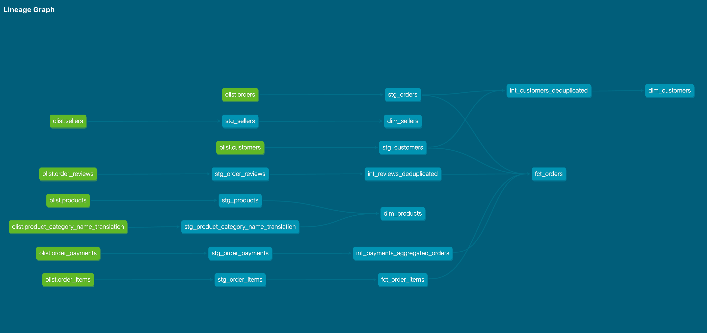

# Olist E-Commerce Analytics Warehouse

A dbt project transforming raw Brazilian e-commerce data into an analytics-ready star schema on Snowflake. Built from the [Olist public dataset](https://www.kaggle.com/datasets/olistbr/brazilian-ecommerce) — ~100k orders, 9 source tables, ~1.5M rows.

**Stack:** Snowflake · dbt Core · SQL

---

## Architecture



| Layer | Materialization | Purpose |
|---|---|---|
| `raw` | tables | Source data loaded as-is via stages and `COPY INTO`. Never modified by dbt. |
| `staging` | views | One model per source table. Casting, renaming, light cleaning. No joins, no business logic. |
| `intermediate` | views | Grain changes — collapsing finer-grained data to the grain marts need. |
| `marts` | tables | Facts and dimensions. The layer analysts query. |

Raw is loaded as all-`VARCHAR` so a single malformed value can never fail the load. Typing happens once, in staging, where a bad cast surfaces as a visible dbt failure rather than a broken pipeline.

---

## Models

**Facts**

| Model | Grain | Rows |
|---|---|---|
| `fct_order_items` | One row per item within an order | 112,650 |
| `fct_orders` | One row per order | 99,441 |

**Dimensions**

| Model | Grain | Rows |
|---|---|---|
| `dim_customers` | One row per person | 96,096 |
| `dim_products` | One row per product, categories translated to English | 32,951 |
| `dim_sellers` | One row per seller | 3,095 |

**Intermediate**

| Model | Purpose |
|---|---|
| `int_customers_deduplicated` | Collapses order-grain customer rows to person grain |
| `int_payments_aggregated_orders` | Collapses payment grain to order grain |
| `int_reviews_deduplicated` | Collapses multiple reviews per order to one |

---

## Modeling Decisions

### Customer identity

A `unique` test on `customer_unique_id` failed with 2,997 duplicates. Investigating showed Olist issues a new `customer_id` for every order placed — the raw `customers` table is one row per order, not one per person. `customer_unique_id` is the stable identifier for the actual human.

`dim_customers` is therefore built at `customer_unique_id` grain via `int_customers_deduplicated`, collapsing 99,441 rows to 96,096. Location is taken from the customer's most recent order, since the primary use of `customer_state` here is present-tense geographic distribution.

Without this step, every customer looks like a one-time buyer and repeat-purchase or lifetime-value analysis is impossible.

### Preventing fan-out

Orders, items, and payments sit at three different grains — 99,441 orders, 112,650 items, 103,886 payments. Joining them directly multiplies rows: an order with 2 items paid in 2 installments produces 4 rows, and every measure on it doubles. Nothing errors; the numbers are just wrong.

Each input is aggregated to order grain *before* joining. Payments are collapsed in `int_payments_aggregated_orders`; items are aggregated in a CTE within `fct_orders`. A `dbt_utils.equal_rowcount` test against `stg_orders` enforces that `fct_orders` stays at exactly 99,441 rows, so any future join that fans out fails the build rather than silently inflating revenue.

### Review grain

`review_id` is not unique. 547 orders carry more than one review, and 789 reviews are linked to multiple orders, making the relationship genuinely many-to-many.

I deduplicated to one review per order, keeping the most recent by `review_creation_date`. This keeps `fct_orders` at a clean order grain and makes `review_score` directly usable.

The trade-off: the 789 multi-order reviews appear against each of their orders, so counting reviews from `fct_orders` will overcount. `stg_order_reviews` remains available for accurate review-level analysis.

An alternative would have been aggregating to `avg_review_score` and `review_count` per order, which preserves more signal. I chose deduplication for simplicity, since fewer than 0.6% of orders are affected.

### Surrogate keys

Used only on `fct_order_items`, where the natural key is composite (`order_id`, `order_item_id`). Hashing it into a single `order_item_key` makes downstream joins and uniqueness tests straightforward.

Dimensions keep their natural keys. With a single source system, stable IDs, and no slowly-changing dimensions, surrogate keys there would add an opaque hash to every join for no benefit.

---

## Data Quality Notes

- **775 orders have no line items** — 603 `unavailable`, 164 `canceled`, and a handful of others. Item and payment measures are set to zero rather than null, since zero items is a true statement about these orders.
- **3 orders have statuses inconsistent with having no items** — one `shipped`, two `invoiced`. An order cannot ship with nothing in it. Apparent source data error, left uncorrected so raw stays faithful to what was received.
- **768 orders have no review.** `review_score` is left null rather than zeroed — unreviewed is not the same as a score of zero.
- **Some products have no category mapping** in the translation table; these are labelled `unknown` rather than left null, so they survive `GROUP BY` and filter predicates.
- **`customer_id` is one-to-one with `order_id`** (both 99,441 distinct), so it carries no information beyond the order key — likely an artifact of the anonymisation applied before this dataset was published.

---

## Testing

XX tests across YY models. Every model has a test asserting its grain — `unique` on the key, or `equal_rowcount` where a join could fan out.

Foreign keys carry `relationships` tests, since Snowflake accepts foreign key declarations but does not enforce them; referential integrity in a warehouse is asserted, not guaranteed. Status and type columns use `accepted_values` as a tripwire for new values appearing in the source.

Tests are written alongside each model rather than added at the end, so a failure points at one suspect instead of several. The `customer_unique_id` finding above came out of exactly this — a test written at staging time, before anything was built on top of it.

---

## Running this project

```bash
pip install dbt-snowflake
dbt deps
dbt build
dbt docs generate && dbt docs serve
```

Requires a Snowflake account with the raw tables loaded. DDL, file format, stage, and `COPY INTO` statements are in `setup/`.

Connection details come from `~/.dbt/profiles.yml`, with credentials supplied through environment variables rather than committed to the repo.

---

## What I'd do next

- **Snapshots** on `order_status` to capture how orders move through fulfilment. The dataset is a static historical dump so nothing changes, but the pattern is what matters for a live source.
- **Incremental materialization** on `fct_order_items`. At 112k rows a full refresh is faster and simpler, so this would be to demonstrate the pattern rather than to solve a real performance problem.
- **CI with GitHub Actions** running `dbt build` on every pull request.
- **Use `stg_geolocations`** — currently built but unconsumed. Joining zip prefixes to customers and sellers would enable distance and regional analysis.